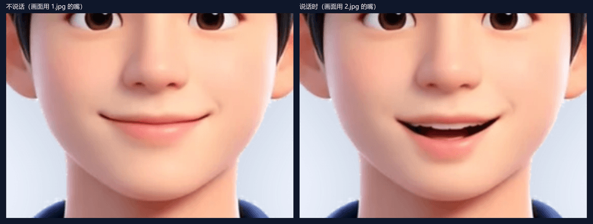
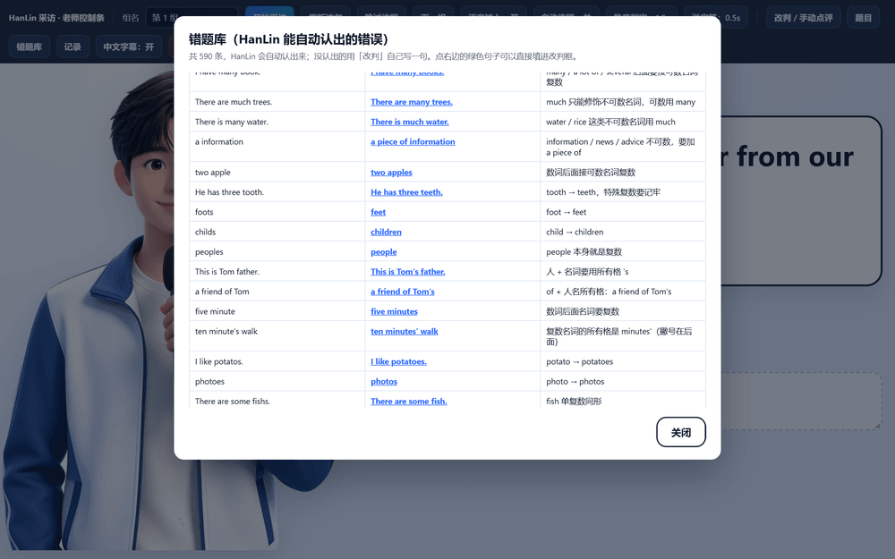
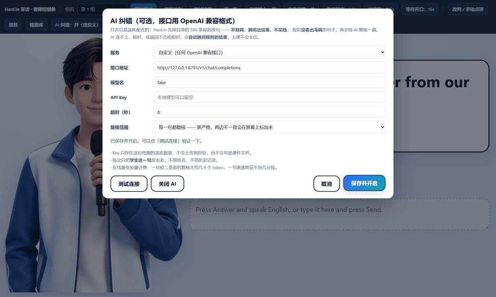
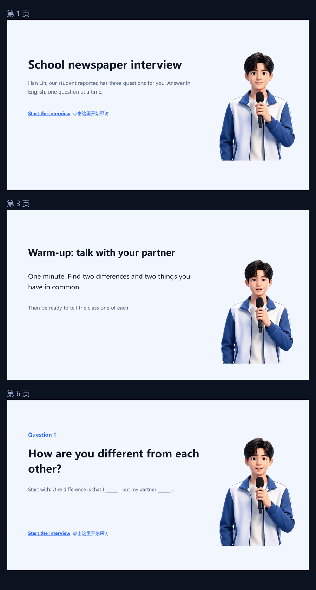

# HanLin 英语采访机器人

一个会说话、会听、会点评的「校报小记者 HanLin」。
初二英语课堂用：按固定顺序问三个问题，学生开口作答，HanLin 当场给出 `Great!` / `Good job!`，或者把学生的句子改对后再点评。


## 它能做什么

- **固定三问，一次只问一个**，流程由程序控制，不会跑题、不会闲聊、不会追问。
- **学生说英语 → 自动转成文字 → 自动提交**，不需要点 Answer 或 Send。
- **两种点评**：没有语法错误就鼓励（`Great!` / `Good job!` 交替）；有错误就把原句改对，屏幕上并排显示「You said / Say it like this」，并逐词高亮改动。
- **双字幕**：英文大字在上，中文小字在下，中文可以一键关掉。
- **人物口型**：说话时嘴巴开合（两帧只换嘴，身体不抖动）。
- **590 条离线纠错规则**，覆盖初中常见易错点（名词、代词、冠词、介词、形容词副词、时态、非谓语、主谓一致、被动、宾从、状从）。
- **可选 AI 复核**：规则没看出的错误交给大模型再判断一次。连不上就自动退回规则模式。
- **记录与导出**：每组的回答存本地，课后可导出 CSV（Excel 直接打开）。

## 三种打开方式

| 方式 | 需要什么 | 听写（学生说话） | 适合 |
| --- | --- | --- | --- |
| **`单文件版/HanLin英语采访.exe`** | 什么都不用装 | **本机离线识别，不联网** | 最省事，推荐 |
| `程序与课件/启动采访-不询问麦克风.bat` | 电脑上有 Edge | 需要联网 | 想改内容、看源码 |
| `程序与课件/HanLin采访-桌面版.exe` | 同文件夹的 3 个 DLL | 需要联网 | 没有 Edge 的电脑 |

单文件版是**一个 exe 里装下了整个采访页、人物、录音、590 条规则和离线语音识别模型**，拷到任何一台 Windows 电脑双击就能用，不弹麦克风询问。

> 免安装 exe 首次运行时，Windows 可能提示「已保护你的电脑」——点**更多信息 → 仍要运行**。

## 采访流程

台词是写死的，不交给模型自由发挥：

```
开场  Hi! I'm Han Lin, reporter from our school newspaper. Now I will interview you.

Q1   How are you different from each other?
Q2   What do you have in common?
Q3   What can you learn from your partner?

收尾  Thank you! You did a wonderful interview.
```

每题结束后的节奏：**朗读题目 → 自动开始收音 → 学生说完停顿约 2 秒 → 自动提交 → 点评 → 下一题**。

## 人物与口型

不说话用 `1.jpg` 的闭嘴帧，说话时把 `2.jpg` 的嘴叠上去。两张图先做了对齐，**只替换嘴部那一小块**，所以身体、衣服、头发一个像素都不会跳。



## 错题库

老师控制条里的「错题库」可以翻看全部 590 条对照（学生可能这样说 → HanLin 改成 → 中文说明），点任意一条可以直接填进「改判」框。



## AI 纠错（可选，默认关）

```
学生说完 → 先跑 590 条离线规则
             ├─ 规则看出毛病 → 直接改句（不联网、瞬间、不花钱）
             └─ 规则没看出毛病 → 交给 AI 复核
                                   ├─ AI 说有错 → 用 AI 改的句子点评
                                   └─ 没错/连不上/超时/乱回答 → 照旧给鼓励
```

支持任何 OpenAI 兼容接口：DeepSeek、Kimi、智谱、通义、硅基流动，或者本地 Ollama / LM Studio。
**API Key 只存在本机浏览器的本地存储里，不写进任何文件，也不在仓库里。**



## 麦克风

学生说「说了没反应」，九成是浏览器没给麦克风权限。页面现在会主动申请，失败时在大屏幕上用中文写清楚怎么办，并给一个「重试」按钮。


## 课件

`程序与课件/英语采访HanLin-完整课件.pptx` 是 10 页成品课件：学习目标 → 热身 → 实用句型 → 采访规则 → 三张题目页 → 收尾 → 老师操作页，页面上的按钮已经用相对路径接到了采访页。



> PPT 和 HTML 必须放在**同一个文件夹**里，按钮才不会失效。

## 目录结构

```
.
├── 单文件版/
│   └── HanLin英语采访.exe          免安装、含离线语音识别
├── 程序与课件/                      完整文件夹版（HTML + PPT + 桌面版 + 麦克风工具）
│   ├── HanLin采访-离线版.html
│   ├── 英语采访HanLin-完整课件.pptx
│   ├── 启动采访-不询问麦克风.bat
│   ├── 上课-独立窗口.bat
│   ├── 麦克风体检.html
│   ├── 切换默认麦克风.bat / .ps1
│   ├── 使用说明.md
│   └── 先看我-怎么加到你自己的PPT.md
├── 源码/                            构建脚本（生成页面、课件、exe）
└── docs/                            README 用的截图
```

## 常见问题

**学生说话没反应？**
先跑 `程序与课件/麦克风体检.html`，它会分别检查权限、设备、音量和听写。或者直接用单文件版。

**听写一定要联网吗？**
网页版是（用的是浏览器自带的识别服务）。**单文件版不需要**，它带本地识别模型。

**换电脑会不会丢东西？**
程序本身不会，拷走整个文件夹就行。但记录和 AI Key 存在本机浏览器里，换电脑要重新填一次 Key；记录请课后导出 CSV。

**能改题目吗？**
能，控制条 → 题目。改完之后 HanLin 的三句台词就用文字/系统语音，不再用预录音频。

## 技术说明

- 网页版是**单文件 HTML**：人物、录音、规则、样式全部内嵌，没有 CDN、没有外部依赖，双击即用。
- 单文件版用 WebView2 + 本地 whisper 模型做识别，打包成一个 exe。
- 课件用 PPTX 生成脚本产出，10 页，版式与完整性校验通过。
- `源码/` 里是构建脚本，路径写死在本机，**仅作参考**，不保证开箱可跑。

## 说明

个人教学用途。仓库里不含任何 API Key、账号信息或学生数据。
